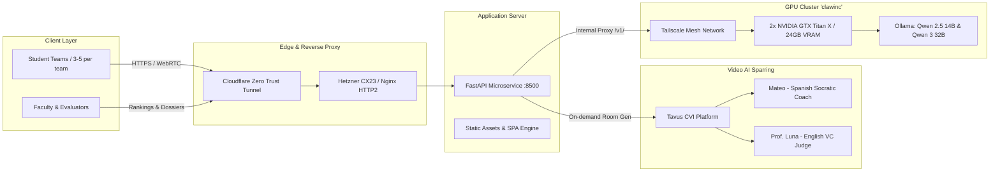

# Anáhuac Innovation & Entrepreneurship Triage System (`AnahuacInnovation`)
### Universidad Anáhuac Mayab — Dirección de Emprendimiento e Innovación

[](https://anahuac-innovation.com/)
[](https://anahuac-innovation.com/)
[](https://anahuac-innovation.com/)
[](https://anahuac-innovation.com/)

---

## 📖 Overview

**Anáhuac Innovation** is an autonomous AI-driven triage, pitch sparring, and consensus evaluation platform developed for the **Universidad Anáhuac Mayab** (Mérida, Yucatán, Mexico).

The platform guarantees the academic standard of **"Objetivo Justo" (Fair Objective)**: ensuring that student entrepreneurship ventures are evaluated objectively through distributed synthetic juries and statistical Z-score calibration, rather than relying on the subjectivity or fatigue of a single human evaluator.

### 🌐 Live Production URL
* **Primary Domain**: [**`https://anahuac-innovation.com/`**](https://anahuac-innovation.com/)
* **Direct SSL Gateway**: [`https://89.167.22.10.sslip.io/`](https://89.167.22.10.sslip.io/)

---

## 🏛️ System Architecture



---

## 🚀 Key Modules

1. **1. Entrega y Registro (Academic Intake)**:
   - Dynamic track segmentation: 2nd Semester (*Innovación / Feria de Prototipos*, TRL 3–4) vs 4th Semester (*Emprendimiento / Business Model Canvas*).
   - Validates required academic deliverables, team members, and video pitches.
   - Generates official timestamped digital folios (`ANH-2026-XXXX`).

2. **2. Cabina de Sparring (Conversational Video Avatars)**:
   - **Mateo (Spanish Mentor)**: Challenges empirical product assumptions, prototyping failures, unit economics, and local market validation.
   - **Prof. Luna (English VC Judge)**: Challenges international scalability, US/LATAM competitive moats, and cross-border defensibility.
   - **Group Calling**: Multi-participant WebRTC rooms (Daily.co) allowing entire 3-5 student teams to connect to the same avatar simultaneously.
   - **1-Hour Sessions**: Configured with 3600-second session tolerances to prevent unexpected room expirations.

3. **3. Panel de 5 Jueces Sintéticos (Consensus Evaluation)**:
   - Evaluates ventures across 5 critical dimensions: Financial Feasibility, Market Validation, Technical Innovation & Moat, Pitch & Storytelling, and Academic Rubric Compliance.
   - Discrepancy detection flag for scores deviating >15 points from the panel mean.
   - Synthesizes an executive consensus verdict for human juries.

4. **4. Tablero y Top 50 Finalistas (Calibrated Z-Score Rankings)**:
   - Cohort-wide normalization ($S_{cal} = 75.0 + 10.0 \times z$) across all 450 projects.
   - Top 50 Finalist badges with cutoff at 88.08/100 and borderline team markers.
   - 1-Page downloadable investor memos / executive dossiers for human judges during the live final.
   - CSV database export for administrative auditing.

5. **5. Rúbrica y Lineamientos Académicos**:
   - Institutional standards, Alexander Osterwalder BMC guidelines, and TRL level requirements.

---

## 📂 Repository Structure

```
AnahuacInnovation/
├── USER_MANUAL.md                         # Detailed Spanish & English User Manual
├── PROJECT_MEMORY_AND_ARCHITECTURE.md     # Engineering log, network routes & configs
├── anahuac_workflow/
│   ├── config.py                          # Endpoints, model IDs, and constants
│   ├── 01_intake_validator.py             # Intake schema validation
│   ├── 02_tavus_sparring_manager.py       # On-demand Tavus sparring room generator
│   ├── 03_synthetic_5judges_panel.py      # 5-judge synthetic jury simulation
│   ├── 04_statistical_calibrator.py       # Z-score normalization & Top 50 selection
│   ├── 05_phase2_dossier_generator.py     # 1-page investor memos generator
│   ├── pipeline_orchestrator.py           # Master CLI orchestrator
│   ├── sample_cohort.json                 # Cohort sample dataset
│   ├── cohort_450_calibrated_ranking.json # 450-project calibrated database
│   ├── cohort_450_calibrated_ranking.csv  # 450-project calibrated CSV ledger
│   └── web_portal/
│       ├── app.py                         # FastAPI web application
│       ├── portal_config.json             # Protected mode configuration
│       ├── static/
│       │   ├── style.css                  # Responsive design system
│       │   ├── app.js                     # SPA frontend application controller
│       │   └── anahuac_mayab_highres.png  # University official logo
│       └── templates/
│           └── index.html                 # Main single-page application template
├── architecture_strategy.qmd              # Quarto architecture paper
├── note on the website.qmd                # Website technical notes
└── publication_outlets.qmd                # Research publication roadmap
```

---

## 🛠️ Quickstart

### Prerequisites
* Python 3.10+
* Git

### Local Web Portal Setup
```bash
# Clone the repository
git clone https://github.com/westland/AnahuacInnovation.git
cd AnahuacInnovation/anahuac_workflow/web_portal

# Install dependencies
pip install fastapi uvicorn pydantic jinja2 python-multipart

# Start local server
uvicorn app:app --host 0.0.0.0 --port 8500 --reload
```
Access the application at `http://localhost:8500/`.

### Run Pipeline via CLI
```bash
cd anahuac_workflow
python pipeline_orchestrator.py --input sample_cohort.json --top-k 50 --output-dir output
```

---

## 📚 User Documentation
For step-by-step guides for students, faculty, and systems administrators, see [**`USER_MANUAL.md`**](USER_MANUAL.md).

For server infrastructure, Tailscale routing, and Tavus PAL IDs, see [**`PROJECT_MEMORY_AND_ARCHITECTURE.md`**](PROJECT_MEMORY_AND_ARCHITECTURE.md).

---

## 👨‍🏫 Authors & Credits
* **Principal Investigator**: Prof. J. Christopher Westland (`westland@uic.edu`)
* **Institution**: Dirección de Emprendimiento e Innovación, **Universidad Anáhuac Mayab**
* **Infrastructures**: Hetzner Cloud (CX23), Local Maxwell Titan X GPU Rig (`clawinc`), Cloudflare Zero Trust, and Tavus AI.
