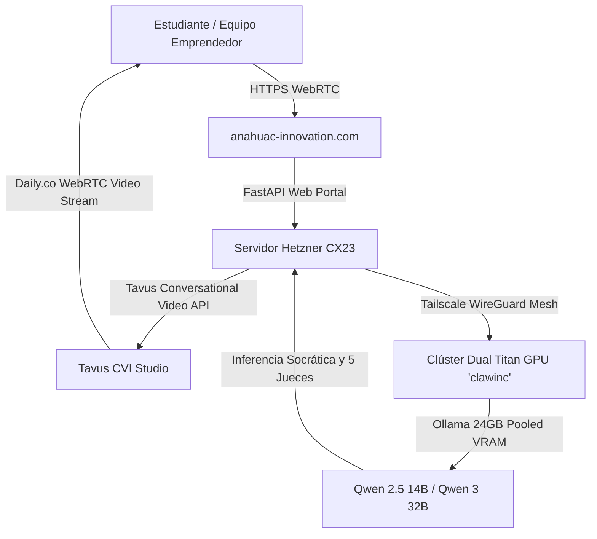

# Manual de Usuario y Guía de Operación
## Plataforma de Innovación y Triage Inteligente — Universidad Anáhuac Mayab
*Dirección de Emprendimiento e Innovación | Enero 2026*

---

## 1. Visión General del Sistema (System Overview)

El **Portal de Proyectos y Triage Inteligente** de la **Universidad Anáhuac Mayab** es un ecosistema tecnológico diseñado para automatizar, estandarizar y enriquecer el proceso de evaluación y preparación oral de emprendimientos universitarios.

El sistema garantiza el principio académico de **"Objetivo Justo" (Fair Objective)**: ningún alumno o equipo depende de la subjetividad o fatiga de un solo juez humano. A través de inteligencia artificial distribuida, simulaciones socráticas 24/7 y calibración estadística rigurosa, se evalúan más de 450 proyectos por ciclo lectivo en dos vertientes curriculares:

1. **Track 1: 2do Semestre (*Innovación / Feria de Prototipos*)**: Demostración empírica de prototipos funcionales (TRL 3–4), validación con usuarios reales y bitácoras de iteración.
2. **Track 2: 4to Semestre (*Emprendimiento / Business Model Canvas*)**: Coherencia económica bajo la metodología de Alexander Osterwalder, métricas de economía unitaria (CAC vs. LTV) y escalabilidad comercial.

---

## 2. Arquitectura de Infraestructura



* **Portal Público en Producción**: [`https://anahuac-innovation.com/`](https://anahuac-innovation.com/) (respaldado por [`https://89.167.22.10.sslip.io/`](https://89.167.22.10.sslip.io/)).
* **Servidor de Aplicación**: Hetzner CX23 (Helsinki), Ubuntu 24.04, Nginx Reverse Proxy con HTTP/2 y compresión Brotli/Gzip, microservicio FastAPI bajo `anahuac-portal.service`.
* **Clúster Local de GPUs**: Nodo `clawinc` con **2x NVIDIA GeForce GTX TITAN X (24 GB VRAM combinada)** ejecutando modelos Qwen 2.5 (14B) para baja latencia conversacional y Qwen 3 (32B) para dictámenes profundos.
* **Avatares Conversacionales en Vivo (Tavus Builder Account)**:
  - **Mateo (Mentor en Español)**: PAL `pd0f8ef69aaf`, Réplica `rbb3d627a705`, voz nativa en español, interruptibilidad baja y detección de turnos *sparrow-2*.
  - **Prof. Luna (English VC Judge)**: PAL `p2f0e8a584be`, Réplica `r983d5889432`, motor ElevenLabs (*Freya*), interruptibilidad baja y paciencia conversacional alta.

---

## 3. Guía Paso a Paso para Estudiantes y Equipos

### Módulo 1: Entrega y Registro de Proyectos (Pestaña 1)

1. **Ingreso al Portal**: Dirígete a [`https://anahuac-innovation.com/`](https://anahuac-innovation.com/).
2. **Selección de Semestre / Track**:
   - Pulsa sobre **"2do Semestre — Feria de Prototipos"** si tu entrega es un prototipo técnico/físico/digital.
   - Pulsa sobre **"4to Semestre — Business Model Canvas"** si tu entrega es un modelo de negocios estructurado.
3. **Llenado de Datos del Equipo**:
   - Nombre del Proyecto y Nombre del Equipo.
   - Correo electrónico institucional `@anahuac.mx`.
   - Nombres de los 3 a 5 integrantes.
4. **Campos Específicos por Track**:
   - *Para 2do Semestre*: Nivel TRL estimado, Descripción del prototipo funcional, Enlace al video demostrativo (YouTube / Vimeo / Drive).
   - *Para 4to Semestre*: Propuesta de valor única, Segmentos de clientes clave, Flujos de ingresos y estructura de costos unitarios.
5. **Carga de Archivo Adjunto**:
   - Arrastra tu documento en formato PDF, PPTX o ZIP (tamaño máximo: 50 MB).
6. **Envío y Generación de Folio**:
   - Presiona **"Registrar y Enviar Proyecto"**.
   - El sistema generará una ventana modal con tu **Folio Institucional Oficial** (ejemplo: `ANH-2026-4821`). Guarda este folio para aclaraciones y seguimiento de calificación.

---

### Módulo 2: Cabina Interactiva de Sparring con Avatar IA (Pestaña 2)

La Cabina de Sparring permite ensayar la defensa oral de 3 minutos frente a un mentor virtual inteligente antes de presentarte ante el jurado humano.

```
+-----------------------------------------------------------------------+
|  CABINA INTERACTIVA DE SPARRING Y ENSAYO DE PITCH                     |
|                                                                       |
|  [ Mateo (Español) ]                   [ Prof. Luna (English) ]      |
|  (Avatar 80px)                         (Avatar 80px)                  |
|  Coach Socrático de Validación         Global VC Pitch Judge          |
|                                                                       |
|  [ Iniciar Sesión en Vivo (1h) ]       [ Launch English Sparring (1h) ]|
|  [ Copiar Enlace Grupal        ]       [ Copy Team Video Link         ]|
+-----------------------------------------------------------------------+
```

#### Modalidades de Uso:

#### A. Ensayo Individual en Vivo (1 Hora)
1. Elige tu avatar:
   - **Mateo (Mentor en Español)**: Cuestiona supuestos empíricos, costos y tracción regional.
   - **Prof. Luna (English Track)**: Cuestiona defensibilidad global, barreras de entrada y escalabilidad transfronteriza.
2. Pulsa en **"Iniciar Sesión de Ensayo en Vivo (1 Hora)"**.
3. Se abrirá la consola interactiva en pantalla con la videollamada WebRTC de alta definición integrada.
4. Permite el acceso a tu micrófono y cámara cuando el navegador lo solicite.
5. Habla naturalmente: el avatar te escuchará, responderá con cadencia fluida y te hará preguntas desafiantes sobre tu proyecto.

#### B. Ensayo en Equipo Grupal (Multi-Participante)
1. Si deseas que **todos los integrantes de tu equipo (3 a 5 personas)** se unan a la misma llamada con el avatar, pulsa **"Copiar Enlace para Reunión en Grupo"**.
2. Envía el enlace copiado a tus compañeros por WhatsApp o Teams.
3. Todos ingresarán a la misma sala WebRTC activa durante 60 minutos ininterrumpidos.

#### C. Cabina de Pitch con Cronómetro de 3 Minutos
1. Dentro del estudio interactivo, selecciona la pestaña **"2. Cabina de Pitch (3 Min) y Desafío Socrático"**.
2. Activa tu cámara web local con el botón **"Activar Mi Cámara Web"**.
3. Presiona **"Comenzar Pitch (3 Minutos)"** para iniciar la cuenta regresiva.
4. Al concluir, el sistema generará un set de **Preguntas Socráticas Inmediatas** calibradas para tu nivel curricular.

---

## 4. Guía para Docentes, Jurados y Evaluadores

### Módulo 3: Panel de 5 Jueces Sintéticos (Pestaña 3)

El panel simula la deliberación colegiada de 5 perfiles académicos y de la industria para cada proyecto:

| Juez Sintético | Especialidad | Enfoque de Evaluación |
| :--- | :--- | :--- |
| **Dr. Fernando Ruiz** | Viabilidad Financiera | Costos unitarios, margen de contribución, CAC vs. LTV, proyecciones de flujo. |
| **Mtra. Sofía Morales** | Validación de Mercado | Entrevistas reales, evidencia de deseabilidad, problemas auténticos vs. inventados. |
| **Ing. Carlos Méndez** | Innovación y Diferenciación | Factibilidad técnica, ventajas competitivas regionales y barreras de imitación. |
| **Lic. Valeria Garza** | Pitch y Comunicación | Estructura narrativa, gancho inicial, síntesis del problema y manejo del tiempo. |
| **Dr. Alejandro H.** | Auditor de Rúbrica Académica | Cumplimiento estricto de entregables institucionales de Anáhuac Mayab (TRL / BMC). |

* **Detección de Discrepancias**: Si la calificación de algún juez se desvía más de 15 puntos del promedio colegiado, el sistema emite una alerta de discrepancia para revisión por el presidente del jurado.
* **Dictamen Sintético**: El meta-juez consolida un veredicto de 3 párrafos explicando fortalezas, debilidades críticas y recomendaciones para la final presencial.

---

### Módulo 4: Tablero y Top 50 Finalistas (Pestaña 4)

El tablero muestra las calificaciones consolidadas de la cohorte completa de 450 proyectos:

1. **Búsqueda y Filtros**:
   - Busca por ID del equipo, nombre del proyecto o filtra por track (2do vs 4to semestre).
2. **Normalización Z-Score (*Objetivo Justo*)**:
   - Cada puntaje se calcula según la fórmula:
     $$S_{cal} = 75.0 + 10.0 \times \left(\frac{x - \mu}{\sigma}\right)$$
   - Esto compensa la varianza de severidad entre distintos paneles evaluadores.
3. **Punto de Corte Top 50**:
   - La nota de corte actual es **88.08 / 100**. Los 50 proyectos sobre este umbral reciben la insignia dorada **"Top 50 Finalista"**.
   - Los proyectos a $\pm 1.0$ punto de la frontera se marcan como *Zona Fronteriza* para revisión humana prioritaria.
4. **Dossier Ejecutivo de 1 Página**:
   - Pulsa el botón **"Ver Dossier"** en cualquier fila para abrir el memorándum ejecutivo del proyecto.
   - El dossier incluye: resumen ejecutivo de 30 segundos, matriz de calificaciones de los 5 jueces y **3 preguntas desafiantes sugeridas** para que el jurado humano interrogue al equipo en la final presencial.
5. **Descarga de Registro Oficial**:
   - Presiona **"Descargar Ranking Oficial en CSV"** para obtener el archivo completo procesable en Excel o R.

---

## 5. Guía Técnica para Administradores de Sistemas

### 5.1 Estructura del Repositorio

```
AnahuacInnovation/
├── anahuac_workflow/
│   ├── config.py                          # Constantes, PAL IDs y endpoints
│   ├── 01_intake_validator.py             # Validador de esquemas curriculares
│   ├── 02_tavus_sparring_manager.py       # Generador de salas dinámicas Tavus
│   ├── 03_synthetic_5judges_panel.py      # Jurado sintético de 5 personas
│   ├── 04_statistical_calibrator.py       # Normalizador Z-score y ranking Top 50
│   ├── 05_phase2_dossier_generator.py     # Generador de dossiers ejecutivos
│   ├── pipeline_orchestrator.py           # Orquestador end-to-end CLI
│   ├── simulate_large_cohort.py           # Generador de cohorte sintética de 450
│   ├── sample_cohort.json                 # Cohorte muestra de prueba
│   ├── cohort_450_calibrated_ranking.json # Base de datos JSON de rankings
│   ├── cohort_450_calibrated_ranking.csv  # Base de datos CSV oficial
│   └── web_portal/
│       ├── app.py                         # Servidor FastAPI
│       ├── portal_config.json             # Configuración de modos protegidos
│       ├── static/
│       │   ├── style.css                  # Hoja de estilos responsiva
│       │   ├── app.js                     # Controlador SPA del cliente
│       │   └── anahuac_mayab_highres.png  # Logotipo oficial de alta resolución
│       └── templates/
│           └── index.html                 # Plantilla base del portal
├── architecture_strategy.qmd              # Documentación Quarto de arquitectura
├── note on the website.qmd                # Notas metodológicas del sitio
├── publication_outlets.qmd                # Estrategia de publicación académica
├── PROJECT_MEMORY_AND_ARCHITECTURE.md     # Bitácora permanente del sistema
├── USER_MANUAL.md                         # Este manual de usuario
└── .gitignore                             # Protección de credenciales y temporales
```

### 5.2 Ejecución del Pipeline en Línea de Comandos

```bash
# Navegar a la carpeta del pipeline
cd anahuac_workflow

# 1. Probar validación de entregas
python 01_intake_validator.py

# 2. Generar una sala de sparring en vivo con Mateo
python 02_tavus_sparring_manager.py

# 3. Correr panel de 5 jueces en muestra
python 03_synthetic_5judges_panel.py

# 4. Correr pipeline completo de 450 proyectos
python pipeline_orchestrator.py --input sample_cohort.json --top-k 50 --output-dir test_output
```

### 5.3 Despliegue Local del Servidor Web

```bash
cd anahuac_workflow/web_portal
pip install fastapi uvicorn pydantic jinja2 python-multipart
uvicorn app:app --host 0.0.0.0 --port 8500 --reload
```
Abre en tu navegador: `http://localhost:8500/`.

### 5.4 Comandos de Mantenimiento en el Servidor de Producción (Hetzner CX23)

```bash
# Conectar por SSH
ssh root@89.167.22.10

# Ver estatus del servicio web
systemctl status anahuac-portal.service

# Reiniciar servicio web tras cambios
systemctl restart anahuac-portal.service

# Recargar Nginx
systemctl reload nginx

# Ver registros en tiempo real
journalctl -u anahuac-portal.service -f
```

---

## 6. Solución de Problemas Frecuentes (FAQ)

### P1: El navegador no muestra el video o audio del avatar.
* **Causa**: Políticas de autoplay de navegadores como Chrome o Safari bloquean el audio no iniciado por clic.
* **Solución**: Asegúrate de haber presionado el botón naranja *"Iniciar Sesión de Ensayo en Vivo"*. Concede permisos de micrófono y cámara en el candado de la barra de direcciones.

### P2: El avatar interrumpe demasiado rápido o se corta la voz.
* **Solución**: Los avatares están configurados con `replica_interruptibility: low` y `sparrow-2`. Si experimentas latencia en la red de tu campus, usa el botón *"Nueva Sala"* en la barra de controles para reasignar un socket WebRTC limpio.

### P3: ¿Cómo se protegen los datos de los alumnos?
* **Seguridad**: Los archivos cargados se almacenan en un volumen local protegido. Las llamadas a los modelos de lenguaje se canalizan de manera cifrada a través de la malla Tailscale WireGuard privada hacia el clúster Titan local, sin enviar prompts a APIs públicas de terceros.

---

*Manual elaborado y mantenido por la Dirección de Emprendimiento e Innovación, Universidad Anáhuac Mayab.*  
*Investigador Principal: Prof. J. Christopher Westland.*
